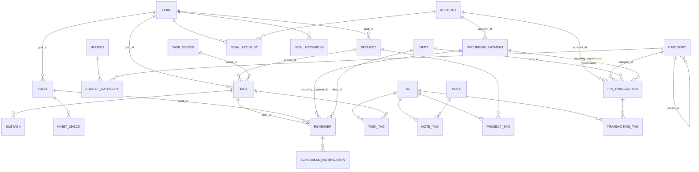

# U-Assistant — модель данных и локальная база (этап 6)

> Статус: **черновик на согласование**. Дата: 23.10.2026.
> Основание: [REQUIREMENTS.md](REQUIREMENTS.md) (§2 термины, §6 финансовые правила, NFR-REL), [UI_SPECIFICATION.md](UI_SPECIFICATION.md) (пункт «База» каждого экрана), [ARCHITECTURE.md](ARCHITECTURE.md).
> СУБД: SQLite (через drift + sqlite3mc, шифрование всего файла). Схема описана на уровне таблиц и правил. Код таблиц drift пишется на этапе 7 строго по этому документу.

---

## 1. Общие соглашения

| Что | Правило | Почему |
|---|---|---|
| Имена | `snake_case`, таблицы в единственном числе | Читаемость SQL |
| Первичный ключ | `id TEXT` — UUID v7, 36 символов, `CHECK (length(id) = 36)` | Создаётся на устройстве, уникален глобально, упорядочен по времени (D-027) |
| Служебные колонки пользовательских записей | `created_at INTEGER NOT NULL`, `updated_at INTEGER NOT NULL`, `deleted_at INTEGER NULL` — миллисекунды UTC | Мягкое удаление и будущая синхронизация (NFR-REL-08) |
| Даты событий | `TEXT 'YYYY-MM-DD'` — локальная календарная дата без пояса | REQUIREMENTS §6.10: «расход 23 октября» не должен стать 22-м при смене пояса |
| Время суток | `TEXT 'HH:MM'` | То же |
| Деньги | `INTEGER` в минимальных единицах + `currency TEXT(3)`; знак — через тип операции | §6.1; никаких `REAL` |
| Курс | `TEXT` — десятичное число строкой (например, `"470.5"`), разбирается через `decimal` | Точность, без `double` |
| Логические | `INTEGER 0/1` + `CHECK (x IN (0,1))` | В SQLite нет BOOLEAN |
| Перечисления | `TEXT` + `CHECK (x IN (...))` | Контролируемые значения вместо свободного текста (мастер-промпт §15) |
| Цвет | `color_index INTEGER 0–6`: индекс в палитре DESIGN_SYSTEM §2.2 | Тема сама подставит светлый или тёмный оттенок; hex в базе не нужен |
| Иконка | `icon TEXT` — ключ из встроенного набора (`cart`, `home`…) | Не зависит от пакета иконок |
| Порядок | `sort_order INTEGER` | Ручная сортировка |
| Длинный текст | `TEXT` Markdown | Заметки, описания |

> **Простыми словами про мягкое удаление.** «Удалить» не стирает строку, а ставит в ней дату `deleted_at`. Все экраны, кроме корзины, такие строки не показывают. Через 30 дней служба очистки удаляет их по-настоящему. Так работает корзина и «Отменить».

**Настройки соединения** (в `beforeOpen`):
- `PRAGMA foreign_keys = ON`;
- `PRAGMA journal_mode = WAL`;
- `PRAGMA busy_timeout = 5000`;
- ключ шифрования — `PRAGMA key` в `setup` (DATA_SECURITY.md).

---

## 2. Какие сущности нужны (разбор списка мастер-промпта)

| Из мастер-промпта | Решение | Почему |
|---|---|---|
| Task | `task` | — |
| Subtask | `subtask` | Простые пункты без дат (допущение REQUIREMENTS §11) — отдельная лёгкая таблица, а не задачи-потомки |
| Project | `project` | — |
| Goal | `goal` + `goal_account` + `goal_progress` | Три типа целей; накопительная привязана к счетам; количественная хранит отметки |
| Note | `note` | — |
| Transaction | `fin_transaction` | `transaction` — ключевое слово SQL, поэтому префикс |
| Account | `account` | — |
| Category | `category` | Двухуровневая через `parent_id` |
| Budget | `budget` + `budget_category` | Бюджет охватывает несколько категорий |
| RecurringRule | **Разделён:** `task_series` (задачи), `recurring_payment` (платежи), расписание внутри `habit` | У трёх видов разные поля и поведение. Общее — только строка правила `rrule`, её разбирает `core/recurrence` |
| Reminder | `reminder` + `scheduled_notification` | Правило напоминания отдельно от того, что сейчас запланировано в ОС (ARCHITECTURE §13) |
| Tag | `tag` | — |
| EntityTag | **Разделён:** `task_tag`, `note_tag`, `project_tag`, `transaction_tag` | Отдельные таблицы позволяют настоящие внешние ключи и каскадное удаление; одна общая таблица держала бы целостность только в коде |
| ActivityLog | `activity_log` | — |
| AppSettings | `app_setting` (ключ — значение) | Настроек немного, схема меняется часто — миграции не нужны на каждую новую настройку |
| VoiceSession | `voice_session` | — |
| VoiceDraft | **Объединён** в `voice_session.drafts_json` | Черновики живут минуты и нужны только для восстановления после сбоя; отдельная таблица с полями всех типов записей была бы громоздкой |
| BackupMetadata | `backup_metadata` | — |
| **Добавлено** | `debt`, `exchange_rate`, `fin_template`, `habit`, `habit_check`, `entity_link`, `change_history`, `import_batch`, `search_index` | Требования FR-FIN-26, 15, 09; FR-HAB; FR-GEN-04; FR-HIS-02; FR-FIN-39; FR-GEN-03 |

---

## 3. ER-диаграмма

**Без внешних ключей** (связь по типу + ID, целостность поддерживается в коде и триггерах):
- `entity_link` — свободные связи «заметка ↔ задача / проект / цель / операция / долг», «задача ↔ операция»;
- `activity_log`, `change_history` — журналы, запись должна пережить удаление объекта;
- `voice_session`, `backup_metadata`, `app_setting`, `exchange_rate` — самостоятельные.

---

## 4. Таблицы

Обозначения в колонке «Огр.»:
- **PK** — первичный ключ;
- **FK→t (R / C / N)** — внешний ключ на таблицу `t` с правилом удаления: R = RESTRICT (запретить), C = CASCADE (удалить вместе), N = SET NULL (обнулить);
- **NN** — NOT NULL;
- **U** — уникальность.

Служебные колонки `id, created_at, updated_at, deleted_at` (§1) есть у всех таблиц с пометкой **[S]** и в списках колонок не повторяются.

### 4.1 `app_setting`
| Колонка | Тип | Огр. | Описание |
|---|---|---|---|
| key | TEXT | PK | `base_currency`, `month_start_day`, `week_start`, `default_reminder_time`, `theme`, `trash_days`, `log_months`, `autobackup_hours`, `autobackup_keep`, `voice_on_device_only`, `voice_history`, `last_account_id`… |
| value | TEXT | NN | JSON-значение |
| updated_at | INTEGER | NN | |

Типы и значения по умолчанию — в `SettingsRepository` (код), а не в базе.

### 4.2 `account` [S]
| Колонка | Тип | Огр. | Описание |
|---|---|---|---|
| name | TEXT | NN, `length` 1–60 | |
| type | TEXT | NN, `IN ('cash','card','bank','deposit','credit','other')` | |
| currency | TEXT | NN, `length = 3`, `= upper(currency)` | ISO 4217 |
| opening_balance_minor | INTEGER | NN, DEFAULT 0 | Может быть отрицательным (кредит) |
| budget_mode | TEXT | NN, `IN ('on_budget','tracking')`, DEFAULT `'on_budget'` | «В бюджете / только отслеживать» (R1) |
| hidden | INTEGER | NN 0/1 | Скрыть из общего баланса |
| archived_at | INTEGER | NULL | |
| color_index, icon, sort_order | | NN | |

- **Индексы:** `(archived_at, sort_order)`.
- **Правила:**
  - `currency` нельзя изменить, если есть операции (триггер `BEFORE UPDATE OF currency` → ошибка, FR-FIN-03);
  - удаление только через DLG-04 (перенос или удаление операций).

### 4.3 `category` [S]
| Колонка | Тип | Огр. | Описание |
|---|---|---|---|
| kind | TEXT | NN, `IN ('expense','income')` | |
| parent_id | TEXT | FK→category (R), NULL | Подкатегория |
| name | TEXT | NN, 1–40 | |
| icon, color_index, sort_order | | NN | |
| default_key | TEXT | U, NULL | Ключ стандартной категории (`food`, `taxi`) — для «Восстановить стандартные» |
| hidden | INTEGER | NN 0/1 | |

- **Индексы:**
  - уникальный частичный `(kind, ifnull(parent_id,''), name COLLATE NOCASE) WHERE deleted_at IS NULL`;
  - `(parent_id)`.
- **Триггер:** родитель должен быть верхнего уровня (`parent.parent_id IS NULL`) и того же `kind`. Максимум 2 уровня.

### 4.4 `exchange_rate` [S]
| Колонка | Тип | Огр. | Описание |
|---|---|---|---|
| currency | TEXT | NN, 3 | Валюта, для которой курс |
| base_currency | TEXT | NN, 3 | Базовая валюта на момент ввода |
| rate | TEXT | NN, `CAST(rate AS REAL) > 0` | Сколько единиц базовой валюты за 1 единицу `currency` |
| valid_from | TEXT | NN, дата | С какого дня действует |

- **Индексы:** уникальный `(currency, base_currency, valid_from) WHERE deleted_at IS NULL`.
- **Правило:** «последний курс» — максимальный `valid_from ≤ сегодня`. «Курс на дату» — максимальный `valid_from ≤ дата`.

### 4.5 `fin_transaction` [S] — центральная таблица финансов
| Колонка | Тип | Огр. | Описание |
|---|---|---|---|
| kind | TEXT | NN, `IN ('expense','income','transfer_out','transfer_in','adjustment','debt_out','debt_in')` | Тип операции |
| status | TEXT | NN, `IN ('posted','planned')` | Фактическая или плановая |
| account_id | TEXT | FK→account (R), NN | |
| category_id | TEXT | FK→category (R), NULL | |
| amount_minor | INTEGER | NN | ≥ 0, кроме `adjustment` |
| currency | TEXT | NN, 3 | Совпадает с валютой счёта (триггер) |
| rate_to_base | TEXT | NULL | Курс, применённый при вводе (§6.4); NULL, если валюта = базовая или курса нет |
| amount_base_minor | INTEGER | NULL | Сумма в базовой валюте, округлена «половина к чётному» один раз при записи (§6.9). NULL = курса нет → «неполный итог» |
| report_effect | TEXT | NN, `IN ('expense','income','none')` | Как операция входит в отчёты доходов и расходов. Вычисляется при записи (§5.2) |
| is_refund | INTEGER | NN 0/1 | Возврат: `income` в категории расходов (FR-FIN-10) |
| date | TEXT | NN | Локальная дата |
| time | TEXT | NULL | |
| note | TEXT | NULL, ≤ 500 | Комментарий |
| transfer_group_id | TEXT | NULL | Общий ID пары перевода |
| debt_id | TEXT | FK→debt (R), NULL | |
| recurring_payment_id | TEXT | FK→recurring_payment (N), NULL | Источник плановой или проведённой по правилу операции |
| voice_session_id | TEXT | NULL | Для «Отменить» голосовой сессии |
| import_batch_id | TEXT | FK→import_batch (N), NULL | Для отмены импорта и поиска дубликатов |

**CHECK-ограничения:**
1. `kind IN ('expense','income') → category_id IS NOT NULL`.
2. `kind <> 'adjustment' → amount_minor >= 0`.
3. `kind IN ('transfer_out','transfer_in') → transfer_group_id IS NOT NULL`.
4. `kind IN ('debt_out','debt_in') → debt_id IS NOT NULL`.
5. `report_effect` согласован с `kind`:
   - `expense` → `'expense'`;
   - `income` → `'income'`;
   - `adjustment`, `debt_*` → `'none'`;
   - переводы → любое (§5.2).
6. `status = 'planned' → recurring_payment_id IS NOT NULL OR kind IN ('expense','income','transfer_out','transfer_in')`.

**Уникальность:**
- `(transfer_group_id, kind) WHERE transfer_group_id IS NOT NULL AND deleted_at IS NULL` — в паре ровно один `out` и один `in`;
- `(recurring_payment_id, date) WHERE status = 'planned' AND deleted_at IS NULL` — правило не создаёт двух плановых на один день.

**Индексы:**
- `(status, date)` — списки, «Сегодня»;
- `(account_id, date)` — баланс и операции счёта;
- `(category_id, date) WHERE report_effect <> 'none'` — аналитика и бюджеты;
- `(transfer_group_id)`, `(debt_id)`, `(recurring_payment_id, status, date)`, `(import_batch_id)`, `(voice_session_id)`.

**Триггеры:**
- `currency` = `account.currency` при вставке и изменении;
- категория `kind` = `expense` для расхода и возврата, `income` для дохода без флага возврата.

### 4.6 `recurring_payment` [S]
| Колонка | Тип | Огр. | Описание |
|---|---|---|---|
| title | TEXT | NN | «Интернет» |
| kind | TEXT | NN, `IN ('expense','income','transfer')` | |
| account_id | TEXT | FK→account (R), NN | |
| to_account_id | TEXT | FK→account (R), NULL | Для `transfer` (`CHECK`) |
| category_id | TEXT | FK→category (R), NULL | Для `expense` / `income` (`CHECK`) |
| amount_minor | INTEGER | NN, > 0 | |
| rrule | TEXT | NN | Подмножество RFC 5545 (§7) |
| start_date | TEXT | NN | |
| end_date | TEXT | NULL | |
| remind_days_before | INTEGER | NULL, 0–30 | |
| auto_post | INTEGER | NN 0/1, DEFAULT 0 | FR-FIN-18 |
| paused | INTEGER | NN 0/1 | |
| note | TEXT | NULL | |

**Плановые экземпляры** — строки `fin_transaction` со `status = 'planned'` на окно 60 дней (ARCHITECTURE §8). Подтверждение меняет `status` на `posted` (сумма может измениться). Изменение правила удаляет будущие плановые записи и создаёт новые. Фактические не трогает.

### 4.7 `budget` [S] и `budget_category`
`budget`:

| Колонка | Тип | Огр. |
|---|---|---|
| name | TEXT | NN |
| limit_minor | INTEGER | NN, > 0 |
| currency | TEXT | NN (= базовая при создании) |
| period | TEXT | NN, `IN ('week','month','year','custom')` |
| custom_start, custom_end | TEXT | NULL; обязательны для `custom` (`CHECK`) |
| repeat | INTEGER | NN 0/1 |
| pinned | INTEGER | NN 0/1 |
| notify_80, notify_100 | INTEGER | NN 0/1 |

`budget_category`: `budget_id` FK→budget (C), `category_id` FK→category (R), PK `(budget_id, category_id)`. Подкатегории включаются при расчёте автоматически, их не нужно добавлять отдельно.

### 4.8 `debt` [S]
| Колонка | Тип | Огр. |
|---|---|---|
| direction | TEXT | NN, `IN ('owed_to_me','i_owe')` |
| counterparty | TEXT | NN, 1–80 |
| currency | TEXT | NN, 3 |
| due_date | TEXT | NULL |
| note | TEXT | NULL |
| closed_at | INTEGER | NULL — проставляется, когда остаток = 0 |

**Остаток не хранится**, а вычисляется из движений `fin_transaction` (`debt_out` / `debt_in`, §6.7). Так нельзя получить расхождение между «остатком» и историей. Списание остатка — операция `expense` / `income` с категорией и записью в `entity_link` на долг (FR-FIN-28).

### 4.9 `fin_template` [S]
`name`, `kind` (`expense`, `income`, `transfer`), `account_id` FK (R), `to_account_id` FK (R) NULL, `category_id` FK (R) NULL, `amount_minor` (NULL = спросить сумму), `note`, `sort_order`.

### 4.10 `project` [S]
| Колонка | Тип | Огр. |
|---|---|---|
| title | TEXT | NN, 1–120 |
| description_md | TEXT | NULL |
| color_index, sort_order | | NN |
| status | TEXT | NN, `IN ('active','paused','done','archived')` |
| deadline | TEXT | NULL |
| goal_id | TEXT | FK→goal (N), NULL |
| completed_at | INTEGER | NULL; `CHECK (status = 'done') = (completed_at IS NOT NULL)` |

### 4.11 `goal` [S], `goal_account`, `goal_progress`
`goal`:

| Колонка | Тип | Огр. |
|---|---|---|
| title | TEXT | NN |
| criterion | TEXT | NULL — «как пойму, что достиг» |
| type | TEXT | NN, `IN ('quantity','savings','outcome')` |
| target_value | INTEGER | Для `quantity` — NN (целое; дробные единицы — через `unit_scale`) |
| unit | TEXT | NULL («книг», «км») |
| unit_scale | INTEGER | NN DEFAULT 0 — знаков после запятой для `quantity` |
| target_minor, target_currency | INTEGER, TEXT | Для `savings` — NN |
| target_date | TEXT | NULL |
| status | TEXT | NN, `IN ('active','achieved','cancelled','archived')` |
| achieved_at | INTEGER | NULL |

Поля по типу проверяются `CHECK`: для `savings` нужны `target_minor` и `target_currency`; для `quantity` — `target_value`.

- `goal_account`: `goal_id` FK (C), `account_id` FK (R), PK. Только для `savings` (проверка в сценарии).
- `goal_progress`: `id`, `goal_id` FK (C), `value INTEGER NN`, `date TEXT NN`, `created_at`. Для `quantity`. Текущее значение — последняя запись по дате.

### 4.12 `task_series` [S]
| Колонка | Тип | Огр. | Описание |
|---|---|---|---|
| rrule | TEXT | NN | Правило (§7) |
| mode | TEXT | NN, `IN ('schedule','completion')` | «По расписанию» или «от даты выполнения» |
| anchor_date | TEXT | NN | Дата отсчёта |
| until_date | TEXT | NULL | Окончание серии |
| count_limit | INTEGER | NULL, > 0 | «После N раз» |
| occurrences_done | INTEGER | NN DEFAULT 0 | Выполнено, пропущено или отменено экземпляров |
| paused_until | TEXT | NULL | `'9999-12-31'` = бессрочно |
| ended_at | INTEGER | NULL | |

> **Простыми словами про повторы.** В базе всегда лежит **один** текущий экземпляр повторяющейся задачи. Когда его выполняют или пропускают, `RecurrenceEngine` вычисляет следующую дату, и создаётся одна новая строка `task` с тем же `series_id`. Будущие экземпляры для календаря вычисляются «на лету» и не хранятся. Так в базе нет тысяч копий (мастер-промпт §8).

### 4.13 `task` [S]
| Колонка | Тип | Огр. | Описание |
|---|---|---|---|
| title | TEXT | NN, 1–300 | |
| description_md | TEXT | NULL | |
| status | TEXT | NN, `IN ('open','done','cancelled','skipped')` | `skipped` — пропуск экземпляра серии |
| priority | INTEGER | NN, 0–3 | 0 — нет, 3 — высокий |
| due_date | TEXT | NULL | Дата выполнения |
| due_time | TEXT | NULL; `CHECK (due_time IS NULL OR due_date IS NOT NULL)` | |
| deadline | TEXT | NULL | Дедлайн (R20) |
| project_id | TEXT | FK→project (N), NULL | |
| goal_id | TEXT | FK→goal (N), NULL | |
| series_id | TEXT | FK→task_series (R), NULL | |
| series_exception | INTEGER | NN 0/1 | Перенесён «только этот раз» (DLG-02) |
| completed_at | INTEGER | NULL; `CHECK (status = 'open') = (completed_at IS NULL)` | Время выполнения, пропуска или отмены |
| sort_order | INTEGER | NN | |
| voice_session_id | TEXT | NULL | |

**Индексы:**
- `(status, due_date)` — «Сегодня», «Предстоящие»;
- `(project_id, status)`, `(goal_id)`;
- уникальный `(series_id) WHERE status = 'open' AND deleted_at IS NULL` — **у серии ровно один открытый экземпляр** (защита от двойного создания следующего).

### 4.14 `subtask`
`id` PK, `task_id` FK→task (C) NN, `title` NN 1–300, `done` 0/1, `sort_order`, `created_at`, `updated_at`. Без мягкого удаления: подзадачи удаляются сразу с «Отменить» в интерфейсе, а при удалении задачи живут вместе с ней в корзине.

### 4.15 `habit` [S] и `habit_check`
`habit`:

| Колонка | Тип | Огр. |
|---|---|---|
| title | TEXT | NN |
| color_index, icon, sort_order | | NN |
| schedule_type | TEXT | NN, `IN ('daily','weekdays','times_per_week')` |
| weekdays_mask | INTEGER | 0–127 (бит 0 = понедельник), NN для `weekdays` |
| times_per_week | INTEGER | 1–7, NN для `times_per_week` |
| daily_target | INTEGER | NN DEFAULT 1 («Вода 3 раза») |
| goal_id | TEXT | FK→goal (N) |
| paused_from, paused_until | TEXT | NULL |
| archived_at | INTEGER | NULL |

`habit_check`: `habit_id` FK (C), `date TEXT`, `count INTEGER NN ≥ 1`, `created_at`. PK `(habit_id, date)`. Серии вычисляются в `core` по отметкам и расписанию, не хранятся.

### 4.16 `reminder` [S]
| Колонка | Тип | Огр. | Описание |
|---|---|---|---|
| task_id | TEXT | FK→task (C), NULL | Владелец — ровно один из четырёх (`CHECK`: сумма `IS NOT NULL` = 1) |
| habit_id | TEXT | FK→habit (C), NULL | |
| recurring_payment_id | TEXT | FK→recurring_payment (C), NULL | |
| debt_id | TEXT | FK→debt (C), NULL | |
| kind | TEXT | NN, `IN ('absolute','offset','daily')` | |
| fire_local | TEXT | `'YYYY-MM-DDTHH:MM'` — для `absolute` | |
| offset_minutes | INTEGER | ≥ 0 — для `offset` («за N минут до» времени задачи, срока платежа или долга) | |
| time_of_day | TEXT | `'HH:MM'` — для `daily` (привычки) | |
| timezone | TEXT | NN | IANA-зона на момент создания |
| enabled | INTEGER | NN 0/1 | |

Почему четыре колонки вместо «тип владельца + ID»: внешние ключи и каскад работают на уровне базы. Удалённая навсегда задача гарантированно не оставит напоминаний.

### 4.17 `scheduled_notification`
| Колонка | Тип | Огр. | Описание |
|---|---|---|---|
| os_id | INTEGER | PK | ID уведомления в ОС (31 бит) |
| reminder_id | TEXT | FK→reminder (C), NN | |
| fire_at | INTEGER | NN | UTC, мс |
| scheduled_at | INTEGER | NN | |

Это служебная таблица: «что сейчас стоит в ОС». Её полностью пересобирает `ReminderScheduler.reconcile()`. В бэкап она **не входит** — на новом устройстве уведомления планируются заново.

### 4.18 `note` [S]
`title TEXT NULL` (если пусто — первая строка), `body_md TEXT NN DEFAULT ''`, `pinned 0/1`, `archived_at INTEGER NULL`, `voice_session_id TEXT NULL`.

Индекс: `(archived_at, pinned, updated_at)`.

### 4.19 `tag` [S] и таблицы тегов
- `tag`: `name TEXT NN 1–40`. Уникальный частичный индекс `(name COLLATE NOCASE) WHERE deleted_at IS NULL`.
- `task_tag`, `note_tag`, `project_tag`, `transaction_tag`: `tag_id` FK→tag (C) + `<entity>_id` FK (C), PK из двух колонок, индекс по второй колонке.

### 4.20 `entity_link`
| Колонка | Тип | Огр. |
|---|---|---|
| id | TEXT | PK |
| a_type, b_type | TEXT | NN, `IN ('task','project','goal','habit','note','transaction','debt')`; `CHECK (a_type < b_type OR (a_type = b_type AND a_id < b_id))` — пара хранится в одном порядке |
| a_id, b_id | TEXT | NN |
| created_at | INTEGER | NN |

- **Уникальность:** `(a_type, a_id, b_type, b_id)`.
- **Индексы:** `(a_type, a_id)`, `(b_type, b_id)`.
- **Допустимые пары** — матрица IA §6.1, проверяются `CHECK` со списком пар.
- **Триггеры `AFTER DELETE`** на каждой связываемой таблице удаляют её связи при окончательном удалении.

### 4.21 `activity_log`
`id` PK, `at INTEGER NN`, `action TEXT NN IN ('created','updated','completed','skipped','reopened','deleted','restored','purged','confirmed','imported','backup_created','restored_backup')`, `entity_type TEXT NN`, `entity_id TEXT NN`, `title_snapshot TEXT NULL` (≤ 120 символов, для показа после удаления), `details_json TEXT NULL`.

Индекс `(at)`. Чистится по сроку `log_months` (FR-HIS-03).

### 4.22 `change_history`
`id` PK, `at INTEGER NN`, `entity_type`, `entity_id`, `field TEXT NN`, `old_value TEXT NULL`, `new_value TEXT NULL`.

Индекс `(entity_type, entity_id, at)`. Пишется сценарием в той же транзакции, что и изменение (только для задач, операций, счетов, бюджетов, целей — FR-HIS-02). Срок — как у журнала.

### 4.23 `voice_session`
| Колонка | Тип | Огр. | Описание |
|---|---|---|---|
| id | TEXT | PK | Ключ идемпотентности сохранения |
| created_at | INTEGER | NN | |
| status | TEXT | NN, `IN ('draft','saved','cancelled')` | |
| engine | TEXT | NN, `IN ('ios_on_device','ios_server','android_system','manual_text')` | |
| recognized_text | TEXT | NULL | Пока `draft` — нужен для восстановления после сбоя. После `saved` / `cancelled` очищается, если история выключена (FR-VOI-10) |
| drafts_json | TEXT | NULL | Черновики; очищается после сохранения |
| saved_at | INTEGER | NULL | |

Сессии `draft` старше 24 часов при запуске предлагаются к продолжению или удаляются [П].

### 4.24 `import_batch`
`id`, `created_at`, `file_name`, `row_count`, `added_count`, `skipped_duplicates`, `status IN ('done','undone')`.

### 4.25 `backup_metadata`
`id`, `created_at`, `kind IN ('auto','manual','safety','pre_migration','pre_risky')`, `file_name`, `size_bytes`, `sha256`, `format_version`, `schema_version`, `app_version`, `encrypted 0/1`, `verified 0/1`, `exported_at INTEGER NULL` (дата успешной внешней передачи).

### 4.26 `search_index` (виртуальная FTS5) [Гипотеза: наличие FTS5 в сборке — проба этапа 7]
`entity_type UNINDEXED`, `entity_id UNINDEXED`, `title`, `body`. Токенизатор `unicode61 remove_diacritics 2` (регистр и «ё/е» не важны [Гипотеза — проверить для кириллицы]).

Заполняется триггерами на `task`, `note`, `project`, `goal`, `habit`, `fin_transaction` (описание + сумма в нескольких написаниях: `3500 3 500 3500,00`), `tag`.

**Запасной вариант без FTS5:** колонка `search_text` (нормализованный нижний регистр, `ё→е`) в каждой таблице + индексированный `LIKE`.

---

## 5. Правила согласованности данных

### 5.1 Сводная таблица инвариантов
| № | Инвариант | Чем обеспечивается | Тест |
|---|---|---|---|
| I1 | Перевод — ровно две записи (`out` и `in`) с общим `transfer_group_id`; создаются, меняются и удаляются вместе | Уникальный индекс + сценарий в одной транзакции | AC-01, AC-02 |
| I2 | Переводы, корректировки и долги не влияют на доходы и расходы | `report_effect` + CHECK | AC-01, AC-19 |
| I3 | Валюта операции = валюта счёта | Триггер | Unit + миграции |
| I4 | Валюту счёта с операциями нельзя изменить | Триггер | FR-FIN-03 |
| I5 | У серии задач не больше одного открытого экземпляра | Уникальный частичный индекс | AC-08 |
| I6 | Напоминание принадлежит ровно одному владельцу | CHECK + FK CASCADE | AC-07 |
| I7 | Остаток долга вычисляется из движений и не хранится | Схема | AC-19 |
| I8 | Сумма в базовой валюте фиксируется при записи и не меняется при новых курсах | Сценарий + тест | AC-17 |
| I9 | Пара в `entity_link` уникальна и допустима | CHECK + уникальный индекс | Unit |
| I10 | Категория не глубже двух уровней и того же типа, что родитель | Триггер | Unit |
| I11 | Голосовая сессия сохраняется не больше одного раза | `status` + проверка в транзакции | AC-04 |
| I12 | Одно правило не создаёт двух плановых операций на один день | Уникальный частичный индекс | Unit |
| I13 | Мягко удалённые записи не участвуют ни в каких расчётах | Все запросы фильтруют `deleted_at IS NULL`; тест на каждый агрегат | Unit |

### 5.2 Как вычисляется `report_effect`
| Операция | `report_effect` |
|---|---|
| `expense` | `expense` |
| `income` (в том числе возврат) | `income`; возврат в отчётах уменьшает расход своей категории (§6.4) |
| Перевод: оба счёта `on_budget` или оба `tracking` | `none` у обеих записей |
| Перевод `on_budget` → `tracking` | `transfer_out`: `expense` (категория обязательна); `transfer_in`: `none` |
| Перевод `tracking` → `on_budget` | `transfer_out`: `none`; `transfer_in`: `income` (категория обязательна) |
| `adjustment`, `debt_out`, `debt_in` | `none` |

При смене `budget_mode` у счёта сценарий пересчитывает `report_effect` его переводов. Это редкая операция, пользователь получает предупреждение.

### 5.3 Как обновление и удаление задачи влияют на напоминания
| Действие с задачей | Что происходит с напоминаниями |
|---|---|
| Изменена дата или время | Строки `reminder` не меняются (типа `offset` они относительные); `reconcile` пересчитывает время. Тип `absolute` — сценарий спрашивает «сдвинуть напоминание?» [П] |
| Выполнена / отменена / пропущена | Напоминания экземпляра выключаются (`enabled = 0`); у нового экземпляра серии — копии с пересчётом |
| Мягко удалена | Строки остаются; `reconcile` не планирует уведомления для владельцев с `deleted_at` → уведомления ОС отменяются (AC-07) |
| Восстановлена из корзины | `reconcile` снова планирует те, у которых время в будущем |
| Удалена навсегда | FK CASCADE удаляет `reminder` и `scheduled_notification`; `reconcile` отменяет уведомления в ОС |
| Проект удалён | Задачи остаются (`project_id` обнуляется при окончательном удалении); при мягком удалении сценарий спрашивает: удалить задачи тоже или перенести во «Входящие» |

### 5.4 Мягкое удаление: что удаляется вместе
| Удаляемое | Вместе с ним (мягко) | Остаётся |
|---|---|---|
| Операция-перевод | Вторая запись пары | — |
| Счёт (DLG-04 «удалить вместе») | Его операции (и вторые записи переводов) | Правила платежей → выключаются |
| Задача | — (подзадачи, напоминания, теги видны вместе с ней) | Связи `entity_link` |
| Проект | По выбору: его задачи | Цель |
| Долг | Его движения | — |
| Категория | Нельзя без переноса операций (DLG-04) | — |

---

## 6. Окончательное удаление и восстановление
- **Окончательное удаление** — `TrashPurger` раз в сутки или «Удалить навсегда»: строки с `deleted_at` старше `trash_days`. Порядок — от зависимых к главным: операции → долги и правила → счета и категории; подзадачи и напоминания уходят каскадом. Перед ручной очисткой корзины — автокопия (FR-BAK-01).
- **Восстановление** — `deleted_at = NULL` у записи и у удалённых вместе с ней (по одинаковому времени удаления и связям, §5.4). Если родитель (проект) удалён окончательно — задача попадает во «Входящие».
- **«Отменить» (5 с)** — то же восстановление.

---

## 7. Формат правил повторения (`rrule`)
Подмножество RFC 5545 (тот же синтаксис, что в календарях), разбирается `core/recurrence`:
- `FREQ=DAILY;INTERVAL=n`
- `FREQ=WEEKLY;BYDAY=MO,WE;INTERVAL=n`
- `FREQ=MONTHLY;BYMONTHDAY=26` или `BYMONTHDAY=-1` (последний день месяца) или `BYDAY=2TU` (второй вторник)
- `FREQ=YEARLY;BYMONTH=3;BYMONTHDAY=1`
- окончание — в колонках `until_date` / `count_limit`, а не в строке (так проще менять).

Неподдерживаемые части строки отвергаются при сохранении (`ValidationFailure`). Граничные случаи (31-е число в коротком месяце, 29 февраля, переход на летнее время — в Казахстане его нет, но у пользователя может быть другой пояс) покрываются unit-тестами.

---

## 8. Деньги в базе: пример
Расход 20,00 USD со счёта «Доллары», курс 470,50 ₸:

| Колонка | Значение |
|---|---|
| kind | `expense` |
| amount_minor | `2000` |
| currency | `USD` |
| rate_to_base | `"470.5"` |
| amount_base_minor | `941000` — 9 410,00 ₸ |

> Расчёт: 20,00 USD = 2000 центов; 2000 × 470,5 = 941 000 тиынов = 9 410,00 ₸. Округление (если результат дробный) — «половина к чётному», один раз. Такие расчёты делает только `core/money` и проверяют тесты (AC-17), а не SQL-запросы.

Отчёты суммируют `amount_base_minor` по `report_effect`. Если в выборке есть `NULL` (курса не было), итог помечается «неполный» (AC-16).

**Если курс добавили позже:** у операций этой валюты с `amount_base_minor IS NULL` значение заполняется по курсу на дату операции (`valid_from ≤ date`). Операции, у которых курс уже был, не пересчитываются (I8).

**Смена базовой валюты** (DLG-10) — отдельный сценарий. Он требует курсы всех используемых валют к новой базе и пересчитывает `amount_base_minor` всех операций одной транзакцией. Перед этим делается автокопия.

---

## 9. Готовность к будущей синхронизации (не реализуется в v1)
- UUID v7 вместо автоинкремента — записи с разных устройств не конфликтуют по ID.
- `updated_at` и `deleted_at` на всех пользовательских таблицах — основа для «что изменилось с момента X» и для удалений («надгробий»).
- Производные данные (остаток долга, серии привычек, балансы) не хранятся — их не нужно синхронизировать.
- Служебные таблицы (`scheduled_notification`, `search_index`, `backup_metadata`) — локальные по определению.

Для v1 этого достаточно. Протокол синхронизации, разрешение конфликтов и журнал изменений проектируются отдельно, если до этого дойдёт.

---

## 10. Миграции
- **Версия схемы 1** — все таблицы этого документа.
- **Процесс:** ARCHITECTURE §11 — ступенчатые миграции drift, снимки схемы в `drift_schemas/`, тест на каждую версию, автокопия перед миграцией.
- **Тестовые данные для миграций:** генератор «типичной базы» (500 операций, 100 задач, переводы, долги, повторы, удалённые записи) в `app/test/fixtures/` — один и тот же для тестов миграций, бэкапа и производительности.

---

## 11. Оценка объёма
Активный пользователь за 3 года:
- ~15 000 операций;
- ~5 000 задач;
- ~1 000 заметок;
- ~3 000 отметок привычек.

Размер базы — порядка 10–20 МБ [Гипотеза; замер на генераторе данных на этапе 7]. Целевые NFR рассчитаны с запасом на 50 000 операций.

---

## 12. Открытые вопросы
1. Наличие FTS5 в сборке sqlite3mc и качество токенизации кириллицы — проба этапа 7.
2. Изменение даты задачи с абсолютным напоминанием: сдвигать молча или спрашивать (§5.3) — предложено спрашивать.
3. Продолжать ли незавершённую голосовую сессию после перезапуска (§4.23) — предложено предлагать в течение 24 часов.
